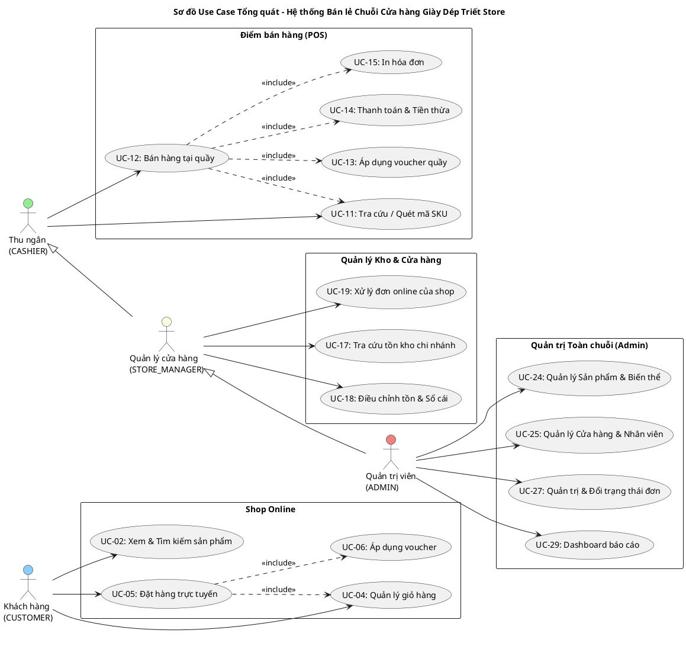

# TÀI LIỆU ĐẶC TẢ USE CASE HỆ THỐNG
## HỆ THỐNG BÁN LẺ CHUỖI CỬA HÀNG GIÀY DÉP "TRIẾT STORE" (WEBSITE + POS + ADMIN)

> **Mã dự án:** DA_HDT_QLDA  
> **Tài liệu phục vụ:** Báo cáo Phân tích Thiết kế Hướng đối tượng & Báo cáo Quản lý dự án  
> **Sơ đồ đính kèm:** [`docs/02-use-case.puml`](file:///c:/Users/Admin/Desktop/workSpace/4_1/DA_HDT/docs/02-use-case.puml)  

---

## 1. DANH SÁCH USE CASE THEO ACTOR VÀ PHÂN HẠNG MoSCoW

Hệ thống bao gồm 4 tác nhân chính: Khách hàng (`CUSTOMER`), Thu ngân (`CASHIER`), Quản lý cửa hàng (`STORE_MANAGER`), và Quản trị viên (`ADMIN`). Trong đó, `STORE_MANAGER` kế thừa toàn bộ quyền của `CASHIER` tại chi nhánh của mình, và `ADMIN` có thẩm quyền quản trị cao nhất trên toàn bộ hệ thống chuỗi.

### 1.1 Tác nhân Khách hàng (`CUSTOMER`) - Phân hệ Shop Online

| Mã UC | Tên Use Case | Phân loại MoSCoW | Mô tả tóm tắt |
|---|---|:---:|---|
| **UC-01** | Đăng ký & Đăng nhập tài khoản | **Must** | Đăng ký tài khoản khách hàng, đăng nhập bằng email/mật khẩu, xác thực phiên làm việc. *(Đã hoàn thành ở V1–V6)* |
| **UC-02** | Xem & Tìm kiếm sản phẩm | **Must** | Xem danh sách sản phẩm giày dép, lọc theo danh mục cha - con, thương hiệu, khoảng giá và tìm kiếm từ khóa. |
| **UC-03** | Xem chi tiết biến thể sản phẩm | **Must** | Xem chi tiết mô tả, hình ảnh gallery, bảng size EU, lựa chọn màu sắc và kích cỡ (biến thể) để hiển thị giá và trạng thái còn hàng. |
| **UC-04** | Quản lý giỏ hàng trực tuyến | **Must** | Thêm biến thể sản phẩm vào giỏ, điều chỉnh số lượng mua, kiểm tra tính sẵn sàng của tồn kho, xóa sản phẩm khỏi giỏ. |
| **UC-05** | Đặt hàng trực tuyến (Checkout) | **Must** | Nhập/chọn thông tin địa chỉ giao hàng, lựa chọn phương thức thanh toán (COD hoặc chuyển khoản/thẻ giả lập), tạo đơn hàng. |
| **UC-06** | Áp dụng mã giảm giá (Voucher) | **Must** | Nhập mã voucher khuyến mãi, hệ thống kiểm tra điều kiện áp dụng và tính toán trừ tiền trên tổng đơn. |
| **UC-07** | Xem lịch sử & chi tiết đơn hàng | **Must** | Khách hàng theo dõi danh sách các đơn hàng đã đặt và tra cứu tiến trình vận chuyển theo thời gian thực. |
| **UC-08** | Quản lý sổ địa chỉ giao hàng | **Must** | Thêm mới, cập nhật danh sách địa chỉ nhận hàng cá nhân, chọn địa chỉ mặc định. *(Đã có schema `addresses`)* |
| **UC-09** | Đánh giá & nhận xét sản phẩm | **Could** | Đánh giá số sao (1-5 sao) và viết nhận xét cho sản phẩm đã mua sau khi đơn hàng chuyển sang trạng thái `COMPLETED`. |

### 1.2 Tác nhân Thu ngân (`CASHIER`) - Phân hệ POS tại quầy

| Mã UC | Tên Use Case | Phân loại MoSCoW | Mô tả tóm tắt |
|---|---|:---:|---|
| **UC-10** | Đăng nhập hệ thống POS | **Must** | Thu ngân đăng nhập tài khoản nhân viên, hệ thống nhận diện chi nhánh làm việc theo phân công. |
| **UC-11** | Tra cứu / Quét mã SKU/Barcode | **Must** | Dùng máy quét mã vạch hoặc gõ trực tiếp SKU/tên sản phẩm trên giao diện bán hàng để thêm ngay vào hóa đơn. |
| **UC-12** | Lập hóa đơn & Bán hàng tại quầy | **Must** | Tạo hóa đơn trực tiếp, thêm/bớt mặt hàng, tự động lấy giá niêm yết từ DB, trừ tồn kho tức thời tại cửa hàng. |
| **UC-13** | Áp dụng voucher tại quầy | **Must** | Nhập mã voucher giảm giá sự kiện tại quầy hoặc voucher do khách hàng cung cấp. |
| **UC-14** | Xử lý thanh toán & Tính tiền thừa | **Must** | Lựa chọn phương thức thanh toán (tiền mặt, thẻ quẹt, mã QR giả lập); tự động tính toán số tiền thừa cần trả lại khách. |
| **UC-15** | In hóa đơn bán lẻ | **Must** | Xuất và in mẫu hóa đơn bán lẻ thanh toán khổ 80mm (hoặc xem trang in Print View) cho khách hàng. |
| **UC-16** | Quản lý ca thu ngân (Mở/Đóng ca) | **Should** | Bắt đầu ca làm việc với số tiền két ban đầu (`opening_cash`), kết ca kiểm đếm tiền mặt (`closing_cash`), đối soát sai lệch. |

### 1.3 Tác nhân Quản lý cửa hàng (`STORE_MANAGER`) - Phân hệ Kho & Vận hành Chi nhánh

| Mã UC | Tên Use Case | Phân loại MoSCoW | Mô tả tóm tắt |
|---|---|:---:|---|
| **UC-17** | Tra cứu tồn kho chi nhánh | **Must** | Xem danh sách số lượng tồn kho từng biến thể tại cửa hàng; lọc danh sách sản phẩm chạm mức cảnh báo `reorder_level`. |
| **UC-18** | Điều chỉnh tồn kho & Xem sổ cái | **Must** | Cập nhật số lượng tồn thực tế (kiểm kê lệch), hệ thống ghi nhận giao dịch điều chỉnh (`ADJUST`) vào sổ cái kho dạng append-only. |
| **UC-19** | Xử lý đơn online của chi nhánh | **Must** | Tiếp nhận đơn hàng online được hệ thống gán về cửa hàng; cập nhật đóng gói (`PACKING`), giao bưu tá (`SHIPPING`). |
| **UC-20** | Yêu cầu chuyển kho nội bộ | **Should** | Tạo phiếu đề xuất điều chuyển hàng hóa (`stock_transfers`) từ kho chi nhánh khác hoặc kho tổng về cửa hàng mình. |
| **UC-21** | Xem báo cáo doanh thu chi nhánh | **Must** | Xem thống kê số lượng đơn và tổng tiền bán được tại quầy trong ngày/tuần của riêng chi nhánh mình phụ trách. |

### 1.4 Tác nhân Quản trị viên (`ADMIN`) - Phân hệ Quản trị Toàn chuỗi

| Mã UC | Tên Use Case | Phân loại MoSCoW | Mô tả tóm tắt |
|---|---|:---:|---|
| **UC-22** | Quản lý Danh mục (Cây cha - con) | **Must** | Quản lý danh mục đa cấp (Danh mục cha: Giày, Dép; Danh mục con: Sneaker, Giày da, Sandal...); hỗ trợ slug SEO, thứ tự sắp xếp. |
| **UC-23** | Quản lý Thương hiệu sản phẩm | **Must** | Thêm, sửa, kích hoạt/ẩn các thương hiệu giày dép phân phối trong chuỗi (Nike, Adidas, Converse, Vans, Biti's, Thượng Đình, Crocs, Dr. Martens). |
| **UC-24** | Quản lý Sản phẩm & Biến thể SKU | **Must** | Tạo sản phẩm cha; cấu hình danh sách biến thể (màu sắc, size, sinh mã SKU duy nhất, mã vạch, giá niêm yết, giá vốn); quản lý URL hình ảnh. |
| **UC-25** | Quản lý Cửa hàng & Nhân viên | **Must** | Quản lý danh sách chi nhánh (cửa hàng bán lẻ, kho trung chuyển, tọa độ GPS); phân bổ nhân viên vào chi nhánh với chức vụ phù hợp. |
| **UC-26** | Quản trị tồn kho toàn hệ thống | **Must** | Xem ma trận tồn kho của tất cả sản phẩm trên toàn bộ các chi nhánh trong chuỗi; tra cứu sổ cái giao dịch kho toàn chuỗi. |
| **UC-27** | Quản trị & Đổi trạng thái đơn | **Must** | Xem danh sách đơn hàng toàn kênh; thực hiện chuyển đổi trạng thái đơn online theo chu trình chuẩn hoặc hủy đơn hoàn kho. |
| **UC-28** | Quản lý Mã giảm giá (Vouchers) | **Must** | Thiết lập chương trình khuyến mãi, tạo mã voucher, loại giảm giá (phần trăm/cố định), mức đơn tối thiểu, số lần sử dụng tối đa. |
| **UC-29** | Dashboard phân tích kinh doanh | **Must** | Biểu đồ doanh thu toàn chuỗi theo mốc thời gian, tỷ trọng doanh thu kênh Online vs POS, top 10 sản phẩm bán chạy, cảnh báo kho. |
| **UC-30** | Tự động định tuyến đơn online | **Should** | Thuật toán tự động tìm cửa hàng gần nhất còn tồn hàng theo công thức khoảng cách Haversine và tính phí vận chuyển động. |

---

## 2. SƠ ĐỒ USE CASE TỔNG QUÁT

Sơ đồ PlantUML tổng quan thể hiện cấu trúc 4 phân hệ và các mối quan hệ giữa các tác nhân và use case cốt lõi. Sơ đồ được lưu tại file riêng [`docs/02-use-case.puml`](file:///c:/Users/Admin/Desktop/workSpace/4_1/DA_HDT/docs/02-use-case.puml).

---

## 3. ĐẶC TẢ CHI TIẾT 4 USE CASE CHÍNH

### 3.1 Use Case 1: Bán hàng tại quầy POS (Mã: UC-12)

- **Tác nhân:** Thu ngân (`CASHIER`), Quản lý cửa hàng (`STORE_MANAGER`).
- **Mục đích:** Hỗ trợ thu ngân lập hóa đơn thanh toán nhanh chóng cho khách mua hàng trực tiếp tại quầy, cập nhật trừ kho tức thì tại chi nhánh, hỗ trợ nhiều phương thức thanh toán và in hóa đơn.
- **Tiền điều kiện (Preconditions):**
  1. Thu ngân đã đăng nhập thành công vào phân hệ POS (`/pos/**`).
  2. Hệ thống đã xác định được chi nhánh (`store_id`) làm việc của thu ngân.
  3. Biến thể sản phẩm bán có trạng thái hoạt động và tồn kho tại cửa hàng $> 0$.

- **Luồng sự kiện chính (Basic Flow):**
  1. Thu ngân mở màn hình Bán hàng tại quầy POS. Hệ thống khởi tạo một phiên hóa đơn nháp mới.
  2. Thu ngân dùng đầu đọc quét mã vạch Barcode hoặc nhập mã SKU/tên sản phẩm vào ô tìm kiếm nhanh.
  3. Hệ thống tìm kiếm biến thể trong CSDL:
     - Lấy thông tin tên sản phẩm, màu sắc, kích cỡ, đơn giá niêm yết từ DB (tuyệt đối không tin giá từ client).
     - Kiểm tra số lượng tồn khả dụng (`quantity_on_hand`) tại cửa hàng hiện tại.
  4. Hệ thống thêm dòng sản phẩm vào bảng hóa đơn với số lượng mặc định là 1 (nếu đã có trong hóa đơn thì tăng số lượng lên 1).
  5. Thu ngân lặp lại bước 2–4 cho đến khi quét đủ các sản phẩm khách mua; có thể điều chỉnh số lượng hoặc xóa dòng sản phẩm nếu khách đổi ý.
  6. Hệ thống tự động tính tổng tiền tạm tính (`subtotal = sum(unit_price * quantity)`).
  7. *(Tùy chọn)* Khách hàng cung cấp mã voucher: Thu ngân nhập mã voucher vào ô khuyến mãi; hệ thống kiểm tra điều kiện và áp dụng tính tiền giảm (`discount_total`) qua mẫu thiết kế **Strategy Pattern** (`DiscountStrategy`).
  8. Hệ thống tính tổng tiền phải thanh toán: `total_amount = subtotal - discount_total`.
  9. Thu ngân chọn hình thức thanh toán:
     - **Tiền mặt:** Thu ngân nhập số tiền khách đưa (`cash_received`). Hệ thống tính toán và hiển thị số tiền thừa cần thối (`change_amount = cash_received - total_amount`).
     - **Thẻ / Quét mã QR:** Hệ thống hiển thị mã QR thanh toán hoặc chờ tín hiệu quẹt thẻ (giả lập thanh toán thành công).
  10. Thu ngân nhấn nút **"Thanh toán & Hoàn tất"**.
  11. Hệ thống thực thi giao dịch trong một transaction duy nhất:
      - Sử dụng **Factory Pattern** (`OrderFactory`) để khởi tạo đơn hàng với kênh `channel = POS`, trạng thái `status = COMPLETED`, gán `store_id` và `cashier_id`.
      - Chụp ảnh snapshot toàn bộ thông tin sản phẩm (tên, màu, size, giá bán) vào bảng `order_items`.
      - Lưu bản ghi thanh toán vào bảng `payments` với trạng thái `PAID`.
      - Bắn sự kiện **Observer Pattern** (`OrderPlacedEvent`) hoặc gọi trực tiếp Domain Service để:
        + Trừ số lượng tồn kho `quantity_on_hand` của biến thể tại cửa hàng tương ứng.
        + Ghi một dòng nhật ký vào sổ cái kho `inventory_transactions` với `type = SALE`, số lượng âm (`-quantity`), tham chiếu `reference_id = order.id`.
      - Cập nhật số lượt sử dụng voucher trong bảng `vouchers` và ghi nhận bản ghi `voucher_usages` (nếu có).
  12. Hệ thống hiển thị thông báo thanh toán thành công và tự động kích hoạt hộp thoại in hóa đơn bán lẻ (Print View khổ 80mm).
  13. Thu ngân xé hóa đơn giao khách và chuyển sang phiên bán hàng mới.

- **Luồng thay thế / Ngoại lệ (Alternative & Exception Flows):**
  - *3a. Không tìm thấy mã sản phẩm:* Hệ thống phát âm thanh cảnh báo lỗi và hiển thị thông báo pop-up: *"Không tìm thấy sản phẩm có mã SKU/Barcode này"*. Con trỏ tự động quay lại ô nhập để thu ngân thử lại.
  - *3b. Hết hàng trong kho cửa hàng:* Số lượng tồn kho tại chi nhánh không đủ đáp ứng số lượng yêu cầu. Hệ thống hiển thị cảnh báo đỏ: *"Sản phẩm [Tên biến thể] chỉ còn tồn [X] cái tại quầy"*. Không cho phép tăng số lượng vượt quá [X].
  - *7a. Voucher không hợp lệ hoặc hết hạn:* Hệ thống hiển thị thông báo lỗi chi tiết (ví dụ: *"Mã giảm giá đã hết lượt sử dụng"* hoặc *"Đơn hàng chưa đạt giá trị tối thiểu 300.000đ"*), không áp dụng giảm giá.
  - *9a. Số tiền mặt khách đưa nhỏ hơn tổng tiền:* Thu ngân nhập số tiền khách đưa nhỏ hơn tổng đơn. Hệ thống vô hiệu hóa nút hoàn tất và hiển thị cảnh báo: *"Tiền khách đưa chưa đủ"*.
  - *11a. Xung đột đồng thời (Optimistic Locking Failure):* Trong tích tắc thanh toán, một giao dịch khác vừa trừ hết tồn kho của biến thể dẫn đến vi phạm phiên bản (`ObjectOptimisticLockingFailureException`). Hệ thống rollback toàn bộ giao dịch, thông báo cho thu ngân: *"Tồn kho sản phẩm vừa có biến động, vui lòng kiểm tra lại giỏ hàng"*.

- **Hậu điều kiện (Postconditions):**
  - Đơn hàng mới được ghi nhận trong bảng `orders` ở trạng thái `COMPLETED`.
  - Tồn kho của các biến thể tương ứng tại chi nhánh bị giảm đúng số lượng bán.
  - Sổ cái kho `inventory_transactions` có các bản ghi xuất hàng `SALE` đầy đủ.
  - Tiền thu được ghi nhận vào báo cáo doanh thu của chi nhánh và ca làm việc.

---

### 3.2 Use Case 2: Đặt hàng trực tuyến (Mã: UC-05)

- **Tác nhân:** Khách hàng (`CUSTOMER`).
- **Mục đích:** Cho phép khách hàng đã đăng nhập đặt mua các sản phẩm giày dép trong giỏ hàng, chọn địa chỉ giao nhận, áp dụng voucher khuyến mãi và khởi tạo đơn hàng online vào hệ thống.
- **Tiền điều kiện (Preconditions):**
  1. Khách hàng đã đăng nhập tài khoản hợp lệ (`role = CUSTOMER`).
  2. Giỏ hàng của khách hàng (`carts`) có ít nhất một mặt hàng hợp lệ.
  3. Các biến thể trong giỏ hàng vẫn còn tồn kho trên hệ thống.

- **Luồng sự kiện chính (Basic Flow):**
  1. Khách hàng truy cập vào trang Giỏ hàng (`/cart`), kiểm tra danh sách sản phẩm, số lượng và nhấn nút **"Tiến hành đặt hàng"**.
  2. Hệ thống chuyển hướng đến trang Thanh toán Checkout (`/checkout`).
  3. Hệ thống nạp danh sách địa chỉ giao hàng đã lưu của khách; khách hàng chọn một địa chỉ hoặc nhập thông tin người nhận mới (Họ tên, Số điện thoại, Tỉnh/Thành phố, Quận/Huyện, Địa chỉ chi tiết).
  4. Hệ thống tải lại giá sản phẩm hiện hành từ CSDL để tính toán `subtotal` (không dùng giá lưu tạm ở client).
  5. Khách hàng nhập mã giảm giá Voucher (nếu có) và nhấn "Áp dụng":
     - Hệ thống kiểm tra điều kiện áp dụng của Voucher thông qua **Strategy Pattern** (`VoucherService` kết hợp `DiscountStrategy`).
     - Tính số tiền được khấu trừ `discount_total` và cập nhật lại tổng tiền.
  6. Hệ thống tính phí vận chuyển `shipping_fee` (mặc định mức cố định hoặc tính theo khoảng cách).
  7. Hệ thống tính tổng tiền thanh toán: `total_amount = subtotal - discount_total + shipping_fee`.
  8. Khách hàng chọn phương thức thanh toán:
     - **Thanh toán khi nhận hàng (COD)** qua `CodPaymentStrategy`.
     - **Thanh toán chuyển khoản/Ví điện tử giả lập (EWALLET_MOCK / QR)** qua `QrPaymentStrategy`.
  9. Khách hàng nhập ghi chú đơn hàng (nếu có) và nhấn nút **"Xác nhận đặt hàng"**.
  10. Hệ thống mở transaction cơ sở dữ liệu:
      - Sử dụng **Factory Pattern** (`OrderFactory`) tạo đơn hàng mới với `channel = ONLINE`, `status = PENDING`.
      - Sao chép toàn bộ thông tin người nhận vào đơn hàng dưới dạng snapshot (`ship_name`, `ship_phone`, `ship_address`).
      - Lưu snapshot từng dòng sản phẩm vào `order_items` (lưu cứng `product_name`, `sku`, `color`, `size`, `unit_price`, `quantity`).
      - Tạo bản ghi thanh toán `payments` tương ứng (trạng thái `PENDING` đối với COD).
      - Nếu có voucher: ghi nhận `voucher_usages` và tăng `used_count` của voucher.
      - Xóa sạch các mặt hàng đã mua khỏi giỏ hàng của khách hàng (`cart_items`).
      - Phát sự kiện ứng dụng **Observer Pattern** (`OrderPlacedEvent`):
        + Bộ lắng nghe sự kiện (`OrderEventListener`) thực hiện trừ tồn kho ngay lập tức tại cửa hàng/kho được phân bổ để tránh bán vượt tồn.
        + Ghi nhận dòng giao dịch `SALE` vào sổ cái `inventory_transactions`.
      - Ghi lịch sử trạng thái ban đầu vào bảng `order_status_history` (`from_status = null`, `to_status = PENDING`).
  11. Hệ thống chuyển hướng khách hàng đến trang **"Đặt hàng thành công"** (`/checkout/success?orderCode=...`) kèm thông tin tóm tắt đơn hàng và hướng dẫn nhận hàng.

- **Luồng thay thế / Ngoại lệ (Alternative & Exception Flows):**
  - *1a. Giỏ hàng rỗng:* Nếu khách cố tình truy cập `/checkout` khi giỏ hàng không có sản phẩm, hệ thống chuyển hướng về trang `/cart` với thông báo lỗi: *"Giỏ hàng của bạn đang trống"*.
  - *4a. Biến thể bị hết hàng trước khi checkout:* Trong quá trình khách duyệt web, sản phẩm trong giỏ đã bị khách khác mua hết tồn kho. Hệ thống phát hiện tồn kho $< \text{số lượng đặt}$, hiển thị thông báo: *"Sản phẩm [Tên biến thể] hiện đã hết hàng, vui lòng điều chỉnh giỏ hàng"* và dừng luồng checkout.
  - *5a. Mã voucher không thỏa mãn:* Mã sai, hết số lượng, hoặc giá trị đơn hàng chưa đạt `min_order_value`. Hệ thống hiển thị flash message báo lỗi, giữ nguyên tổng tiền ban đầu.
  - *10a. Lỗi trừ kho đồng thời:* Khóa lạc quan `@Version` phát hiện xung đột dữ liệu. Giao dịch rollback hoàn toàn, giỏ hàng được bảo lưu và hệ thống yêu cầu khách hàng thử đặt lại.

- **Hậu điều kiện (Postconditions):**
  - Một đơn hàng mới được tạo trong `orders` với trạng thái `PENDING` và mã đơn hàng duy nhất (`order_code`).
  - Tồn kho sản phẩm bị giảm ngay lập tức; sổ cái kho ghi nhận giao dịch `SALE`.
  - Giỏ hàng của khách hàng được dọn sạch các sản phẩm đã đặt mua.
  - Mã voucher bị giảm 1 lượt dùng khả dụng.

---

### 3.3 Use Case 3: Xử lý đơn online & Chuyển đổi trạng thái (Mã: UC-27)

- **Tác nhân:** Quản trị viên (`ADMIN`), Quản lý cửa hàng (`STORE_MANAGER`).
- **Mục đích:** Quản lý quy trình xử lý đơn hàng từ lúc khách đặt mua online đến khi giao hàng thành công hoặc hủy đơn; đảm bảo tính toàn vẹn nghiệp vụ qua mẫu thiết kế **State Pattern** và tự động hoàn kho qua **Observer Pattern** khi đơn bị hủy.
- **Tiền điều kiện (Preconditions):**
  1. Người dùng đã đăng nhập tài khoản có quyền `ADMIN` hoặc `STORE_MANAGER`.
  2. Đơn hàng cần xử lý đang tồn tại trong hệ thống.

- **Vòng đời chuẩn của đơn hàng Online:**
  $$\text{PENDING} \xrightarrow{\text{Xác nhận}} \text{CONFIRMED} \xrightarrow{\text{Đóng gói}} \text{PACKING} \xrightarrow{\text{Xuất bưu tá}} \text{SHIPPING} \xrightarrow{\text{Giao thành công}} \text{COMPLETED}$$
  $$\text{PENDING / CONFIRMED / PACKING} \xrightarrow{\text{Hủy đơn}} \text{CANCELLED}$$

- **Luồng sự kiện chính (Chuyển trạng thái giao hàng thành công):**
  1. Quản trị viên/Quản lý truy cập màn hình Danh sách Đơn hàng (`/admin/orders`).
  2. Người dùng tìm kiếm và chọn một đơn hàng đang ở trạng thái `PENDING`.
  3. Hệ thống nạp chi tiết đơn hàng, danh sách sản phẩm và hiển thị các nút thao tác chuyển trạng thái hợp lệ dựa trên lớp trạng thái hiện tại (**State Pattern** - `PendingOrderState`).
  4. Quản lý kiểm tra thông tin địa chỉ và hàng hóa, nhấn nút **"Xác nhận đơn hàng"**.
  5. Hệ thống gọi phương thức `order.confirm()`:
     - Lớp `PendingOrderState` kiểm tra tính hợp lệ và cho phép chuyển sang `CONFIRMED`.
     - Cập nhật trường `orders.status = CONFIRMED`.
     - Thêm một bản ghi vào `order_status_history` (`from_status = PENDING`, `to_status = CONFIRMED`, `changed_by = user.id`, `note = 'Đã liên hệ xác nhận'`).
  6. Khi kho thực hiện soạn đồ xong, nhân viên nhấn **"Bắt đầu đóng gói"**:
     - Lớp `ConfirmedOrderState` chuyển trạng thái sang `PACKING`.
     - Ghi nhận lịch sử `order_status_history`.
  7. Khi đơn được bàn giao cho đơn vị vận chuyển, nhân viên nhấn **"Giao cho bưu tá"**:
     - Lớp `PackingOrderState` chuyển trạng thái sang `SHIPPING`.
     - Ghi nhận lịch sử `order_status_history`.
  8. Khi khách nhận hàng và trả tiền (đối với COD), nhân viên nhấn **"Hoàn tất giao hàng"**:
     - Lớp `ShippingOrderState` chuyển trạng thái sang `COMPLETED`.
     - Cập nhật thời điểm hoàn tất `completed_at = NOW()`.
     - Cập nhật trạng thái thanh toán trong `payments` sang `PAID` (nếu là đơn COD).
     - Ghi nhận lịch sử `order_status_history`.

- **Luồng thay thế: Hủy đơn hàng và Hoàn kho tự động (Cancellation & Restock Flow):**
  - *4a. Hủy đơn hàng khi khách đổi ý hoặc không liên lạc được:*
    1. Tại các trạng thái `PENDING`, `CONFIRMED` hoặc `PACKING`, người quản lý nhấn nút **"Hủy đơn hàng"**, nhập lý do hủy.
    2. Lớp trạng thái tương ứng kiểm tra điều kiện hủy hợp lệ và chuyển trạng thái sang `CANCELLED`.
    3. Hệ thống cập nhật `orders.status = CANCELLED` và ghi nhận bản ghi vào `order_status_history`.
    4. Hệ thống phát sự kiện **Observer Pattern** (`OrderCancelledEvent`):
       - Bộ lắng nghe `OrderEventListener` bắt sự kiện và thực hiện hoàn trả lại tồn kho:
         + Cộng lại số lượng hàng tương ứng vào `quantity_on_hand` của từng biến thể tại cửa hàng phụ trách đơn.
         + Ghi một dòng giao dịch hoàn kho vào sổ cái `inventory_transactions` với `type = CANCEL`, số lượng dương (`+quantity`), `reference_id = order.id`.
       - Nếu đơn hàng có sử dụng voucher: giảm `used_count` của voucher đi 1 để trả lại lượt dùng cho khách.
    5. Hệ thống hiển thị thông báo: *"Đã hủy đơn hàng thành công và tự động hoàn trả hàng về kho"*.

- **Ngoại lệ: Chuyển trạng thái sai quy trình (Illegal State Transition):**
  - Nếu người dùng cố tình can thiệp API hoặc gửi request chuyển trạng thái nhảy cóc (ví dụ: từ `PENDING` nhảy thẳng lên `COMPLETED` hoặc từ `SHIPPING` bấm `Hủy đơn`):
    + Lớp State tương ứng ném ngoại lệ nghiệp vụ `IllegalStateException` ("Không thể chuyển trạng thái từ X sang Y").
    + Transaction bị chặn, hệ thống trả về thông báo lỗi chi tiết cho người dùng và giữ nguyên trạng thái cũ của đơn hàng.

- **Hậu điều kiện (Postconditions):**
  - Trạng thái đơn hàng trong CSDL được cập nhật chính xác.
  - Mọi bước thay đổi đều có vết kiểm toán trong `order_status_history`.
  - Hàng hóa trong kho được bảo toàn chính xác (không bị mất mát hay lệch số liệu khi hủy đơn).

---

### 3.4 Use Case 4: Quản lý tồn kho theo cửa hàng (Mã: UC-18 / UC-26)

- **Tác nhân:** Quản lý cửa hàng (`STORE_MANAGER`), Quản trị viên (`ADMIN`).
- **Mục đích:** Theo dõi số lượng tồn kho thực tế của từng biến thể sản phẩm theo từng chi nhánh độc lập, cảnh báo hàng sắp hết và thực hiện điều chỉnh tồn kho (kiểm kê hàng thừa/thiếu) có ghi nhận nhật ký giao dịch minh bạch.
- **Tiền điều kiện (Preconditions):**
  1. Người dùng đã đăng nhập với vai trò `STORE_MANAGER` (chỉ xem cửa hàng mình) hoặc `ADMIN` (xem toàn chuỗi).
  2. Dữ liệu cửa hàng và danh mục biến thể sản phẩm đã được cấu hình trong hệ thống.

- **Luồng sự kiện chính (Basic Flow):**
  1. Người dùng truy cập phân hệ Quản lý Kho (`/admin/inventory` hoặc `/pos/inventory`).
  2. Hệ thống hiển thị bảng ma trận tồn kho:
     - Nếu là `STORE_MANAGER`: Tự động khóa điều kiện lọc theo cửa hàng mà người dùng đang quản lý.
     - Nếu là `ADMIN`: Cho phép chọn lọc theo bất kỳ cửa hàng nào trong danh sách toàn chuỗi.
  3. Màn hình hiển thị danh sách biến thể với các thông tin: Mã SKU, Tên sản phẩm, Màu sắc, Size, Số lượng tồn khả dụng (`quantity_on_hand`), Ngưỡng cảnh báo (`reorder_level`), và Trạng thái cảnh báo (Bình thường / Sắp hết hàng nếu tồn $\le$ `reorder_level`).
  4. Người dùng lọc nhanh các sản phẩm đang có cờ cảnh báo *"Sắp hết hàng"* để lên kế hoạch bổ sung.
  5. Khi thực hiện kiểm kê định kỳ tại cửa hàng phát hiện lệch số lượng, người quản lý nhấn nút **"Điều chỉnh tồn kho"** tại dòng biến thể cần chỉnh.
  6. Hệ thống hiển thị hộp thoại điều chỉnh:
     - Hiển thị số tồn hiện tại trên phần mềm.
     - Cho phép nhập số lượng thực tế kiểm kê được hoặc số lượng điều chỉnh tăng/giảm ($\pm$).
     - Bắt buộc nhập lý do điều chỉnh (ví dụ: *"Hàng lỗi rách bao bì"*, *"Kiểm kê định kỳ phát hiện thừa 1 đôi"*).
  7. Người dùng nhấn nút **"Xác nhận điều chỉnh"**.
  8. Hệ thống mở giao dịch kiểm tra và cập nhật:
     - Sử dụng cơ chế khóa lạc quan: Đọc bản ghi `inventories` kèm giá trị phiên bản `version`.
     - Tính toán số lượng thay đổi `quantity_change = new_qty - old_qty`.
     - Kiểm tra điều kiện nghiệp vụ: Số tồn sau điều chỉnh không được âm ($new\_qty \ge 0$).
     - Cập nhật số tồn mới `quantity_on_hand = new_qty`, tăng `version = version + 1`.
     - Ghi nhận một bản ghi biến động vào sổ cái `inventory_transactions`:
       + `variant_id`: ID biến thể.
       + `store_id`: ID cửa hàng điều chỉnh.
       + `type`: `ADJUST`.
       + `quantity_change`: Giá trị tăng hoặc giảm ($\pm$).
       + `quantity_after`: Số lượng tồn kho mới sau điều chỉnh.
       + `note`: Lý do điều chỉnh do người dùng nhập.
       + `created_by`: ID tài khoản thực hiện.
  9. Hệ thống đóng giao dịch, hiển thị thông báo cập nhật thành công và cập nhật lại số liệu tức thì trên giao diện bảng tồn kho.

- **Luồng thay thế / Ngoại lệ (Alternative & Exception Flows):**
  - *8a. Số tồn sau điều chỉnh là số âm:* Người dùng vô tình nhập số lượng thực tế là số âm hoặc giảm vượt quá số đang có. Hệ thống chặn lại và báo lỗi nghiệp vụ: *"Số lượng tồn kho không thể nhỏ hơn 0"*.
  - *8b. Xung đột phiên bản dữ liệu (Optimistic Locking Concurrency Conflict):* Trong lúc người quản lý đang mở form điều chỉnh, quầy thu ngân POS vừa bán một sản phẩm của biến thể này dẫn đến `version` trong CSDL đã tăng lên. Khi quản lý bấm xác nhận, hệ thống phát hiện lệch `version` và ném ngoại lệ `OptimisticLockException`. Hệ thống rollback giao dịch và hiển thị thông báo: *"Dữ liệu tồn kho vừa được cập nhật bởi một giao dịch khác. Vui lòng tải lại trang và thực hiện lại"*.
  - *8c. Phân quyền truy cập trái phép:* `STORE_MANAGER` cố tình truyền mã `store_id` của một cửa hàng khác trên URL. Hệ thống phát hiện vi phạm phân quyền, chặn request và trả về mã lỗi `403 Forbidden`.

- **Hậu điều kiện (Postconditions):**
  - Bản ghi tồn kho `inventories` của biến thể tại cửa hàng được cập nhật số lượng mới và tăng số phiên bản `version`.
  - Sổ cái kho `inventory_transactions` được bổ sung một dòng giao dịch loại `ADJUST` với đầy đủ vết kiểm toán.
  - Số liệu trên Dashboard quản trị được làm mới tương ứng.

